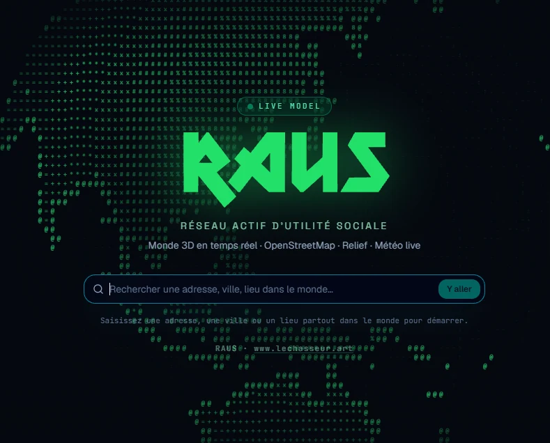
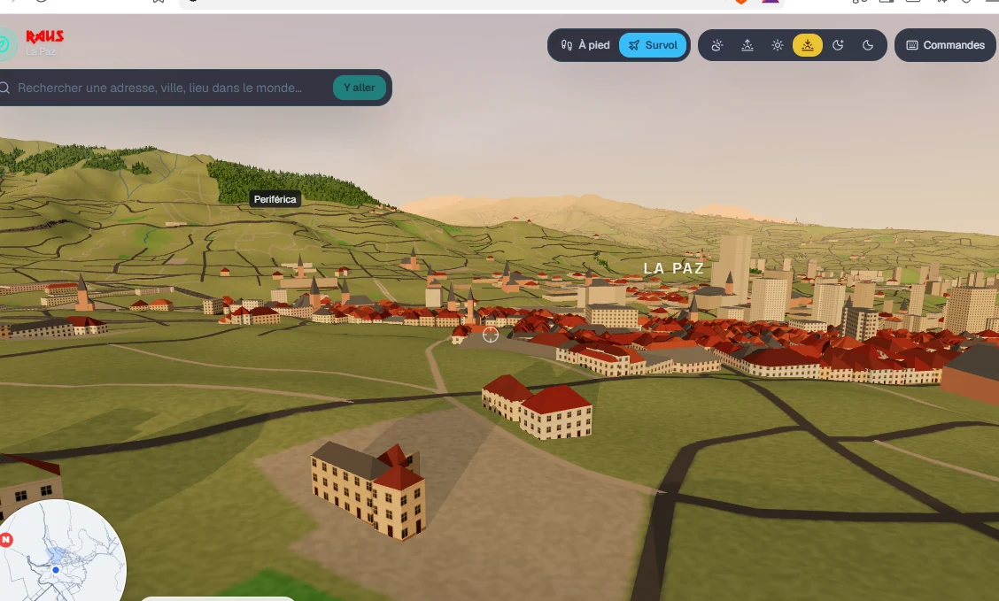
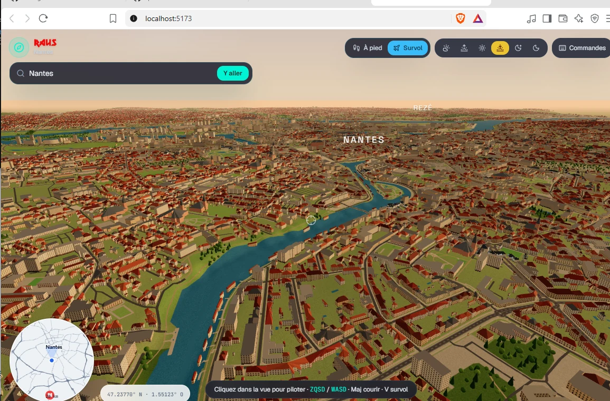
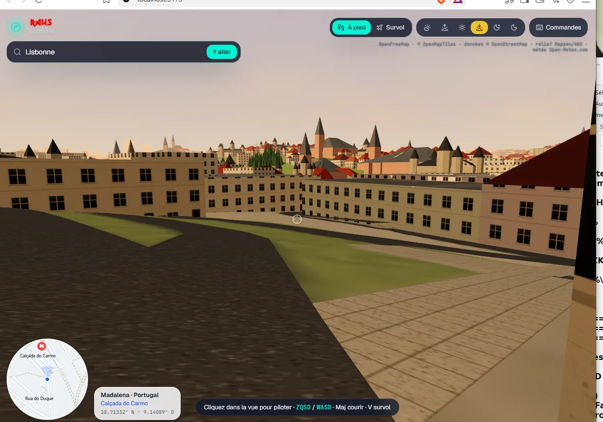

# RAUS — Réseau Actif d'Utilité Sociale

**RAUS** · **[www.lechasseur.art](https://www.lechasseur.art)** · **[Démo en ligne](https://roadwalk-3d.vercel.app)**

> ▶ **Essayer maintenant : <https://roadwalk-3d.vercel.app>** — aucune installation, aucune clé.

Moteur 3D temps réel du monde entier en **Three.js + FastAPI**, ultra-léger, **100 % gratuit** et sans aucune clé API payante. Conçu comme socle réutilisable pour GPS 3D, jeux, géocaching, pèlerinages et trails.

> ### Condition d'utilisation
> Ce moteur est libre (MIT) **à une condition d'attribution** : toute réutilisation, tout dérivé
> et toute mise en ligne doivent **citer le nom « RAUS »** et le site **www.lechasseur.art**
> (avec un lien cliquable vers <https://www.lechasseur.art>).

## Captures d'écran

**Écran d'accueil — LIVE MODEL : globe ASCII, logo RAUS et recherche mondiale**



| Survol — La Paz, Bolivie | Survol — Nantes et la Loire |
| :---: | :---: |
|  |  |

**À pied — Lisbonne, Calçada do Carmo (rues étroites, relief et façades à hauteur d'homme)**



## Sources de données (100 % gratuites & monde entier)

| Couche | Source | Clé API |
| :--- | :--- | :--- |
| Tuiles vectorielles (bâtiments, routes, eau, forêts, lieux) | [OpenFreeMap](https://openfreemap.org/) (OpenStreetMap) | Aucune |
| Relief mondial (MNT 129×129 / tuile) | [AWS Terrain Tiles (Terrarium)](https://registry.opendata.aws/terrain-tiles/) | Aucune |
| Météo & soleil en direct | [Open-Meteo](https://open-meteo.com/) | Aucune |
| Géocodage | OSM Nominatim (+ BAN France) | Aucune |
| Empreintes bâtiments de secours | Microsoft GlobalMLBuildingFootprints (ODbL) | Aucune |

## Architecture

- **Backend (`backend/`)** : FastAPI + cache SQLite local (`data/cache.sqlite3`) qui réduit chaque tuile vectorielle `z=14` en JSON compact et décode le relief Terrarium.
- **Worker 3D (`frontend/src/viewer/tile.worker.ts`)** : construit la géométrie hors thread principal et peint routes au sol, trottoirs, chemins et rivières sur une texture `groundImage` (`1024×1024`, `round` caps/joins) pour éviter tout z-fighting et réduire le nombre de triangles. Seuls les vrais ponts (tablier + garde-corps) et portails de tunnels restent en géométrie 3D.
- **Moteur (`frontend/src/viewer/Engine.ts`)** : rendu Three.js, marche/survol, météo/soleil live, éclairage nocturne instancié, et surcouche GPS (`overlays.ts`).
- **Mini-plan GPS (`frontend/src/components/Plan2D.tsx`)** : boussole circulaire `160×160` orientée selon le cap, routes/chemins/rivières uniquement, thème automatique jour/nuit.

## Démarrage rapide

### Windows
Double-cliquer sur `run.bat` (nettoie les ports `8001` et `5173`, prépare le venv Python et lance backend + frontend).

### Manuel (Linux / macOS / Windows)
```bash
# 1. Backend (port 8001)
cd backend
python -m venv .venv
.venv/bin/pip install -r requirements.txt
.venv/bin/uvicorn server:app --host 127.0.0.1 --port 8001

# 2. Frontend (port 5173)
cd frontend
npm install
npm run dev
```

## API Moteur (`frontend/src/viewer`)

```ts
import { Engine } from "@/viewer";

const engine = new Engine(containerElement, {
  onHud: (hud) => { /* état temps réel */ },
  onTeleport: (phase, label) => { /* leaving | loading | arriving | done */ },
  onError: (msg) => console.error(msg),
  onLockChange: (locked) => {},
}, { lat: 47.8861, lon: 7.2292 });

// 1. Se déplacer vers n'importe quelles coordonnées
await engine.goTo(48.8584, 2.2945, { label: "Tour Eiffel" });

// 2. Poser un marqueur 3D ancré au relief
const pin = engine.addPin({
  lat: 48.8584,
  lon: 2.2945,
  color: "#ef4444",
});
// pin.remove();

// 3. Tracer un itinéraire GeoJSON ou GPX sur le terrain
const track = engine.addTrack({
  type: "LineString",
  coordinates: [
    [7.228, 47.885],
    [7.230, 47.887],
  ],
}, { color: "#06b6d4" });

// Ou directement une chaîne GPX XML :
engine.addTrack(gpxXmlString, { color: "#f59e0b" });
// track.remove();

// 4. Écouter les déplacements
const unsubscribe = engine.onMove((pos) => {
  console.log(pos.lat, pos.lon, pos.heading, pos.altitude);
});
```

## Attribution des données

Ce moteur affiche des données sous licence ; les mentions suivantes sont **obligatoires** et sont
affichées en permanence dans l'interface (coin supérieur droit) ainsi que dans le menu *Commandes* :

```
OpenFreeMap · © OpenMapTiles · données © OpenStreetMap · relief Mapzen/AWS · météo Open-Meteo.com
```

- [OpenFreeMap](https://openfreemap.org/) — hébergement des tuiles vectorielles, licence MIT, instance publique gratuite sans limite de requêtes.
- [© OpenMapTiles](https://www.openmaptiles.org/) — schéma des tuiles.
- [© contributeurs OpenStreetMap](https://www.openstreetmap.org/copyright) — données cartographiques (ODbL).
- [Mapzen / AWS Terrain Tiles](https://github.com/tilezen/joerd/blob/master/docs/attribution.md) — relief mondial (Terrarium).
- [Open-Meteo.com](https://open-meteo.com/) — météo et soleil en direct (CC BY 4.0).
- Microsoft Building Footprints (ODbL) — empreintes de secours là où OpenStreetMap est muet.

Les requêtes sortantes sont plafonnées à **4 simultanées** vers OpenFreeMap, conformément à ses
conditions d'utilisation.

## Attribution

Ce projet est **RAUS — Réseau Actif d'Utilité Sociale**, publié par **www.lechasseur.art**.

Toute réutilisation du code, totale ou partielle, tout dérivé et toute mise en ligne doivent
conserver une mention visible :

```
Basé sur RAUS — Réseau Actif d'Utilité Sociale — https://www.lechasseur.art
```

## Licence

MIT — voir [`LICENSE`](./LICENSE). La condition d'attribution est décrite dans
[`ATTRIBUTION.md`](./ATTRIBUTION.md) et fait partie des conditions de réutilisation.
